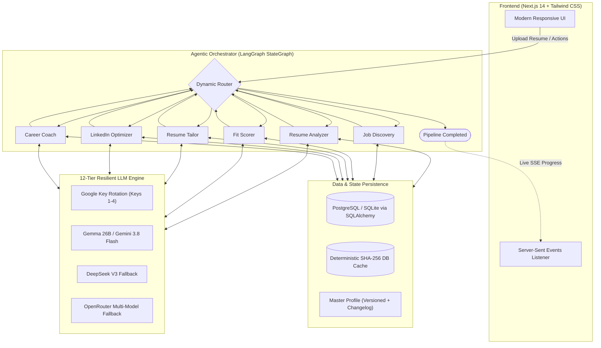

# CareerPilot

<div align="center">

[](https://career-pilot-lac.vercel.app)
[](https://careerpilot-api-qp1o.onrender.com/health)
[](https://render.com/deploy?repo=https://github.com/Aamirbadar07/CareerPilot)
[](docs/audit/TEST_REPORT.md)
[](docs/audit/RECRUITER_EVALUATION.md)

**An autonomous multi-agent career acceleration platform built with LangGraph, FastAPI, and Next.js 14.**  
Transforms unformatted resumes into verified master profiles, discovers matched jobs across licensed feeds, performs calibrated multi-dimensional scoring, tailors ATS-optimized single-page resumes with zero hallucinations, and generates personalized career coaching roadmaps.

[Live Application](https://career-pilot-lac.vercel.app) • [Interactive API Docs (Swagger)](https://careerpilot-api-qp1o.onrender.com/docs) • [Architecture Guide](docs/architecture.md) • [Engineering Audits](docs/audit/)

</div>

---

## 🎯 Core Engineering Principles

Traditional career tools either hallucinate candidate credentials or resort to brittle, terms-violating web scraping. CareerPilot is engineered on two foundational invariants:

1. **Deterministic Factual Grounding (Zero Hallucination)**:  
   Every tailored resume bullet point is strictly traceable to verified facts in the candidate's master profile. A deterministic code guard rejects ungrounded metrics, fabricated user counts, and unsupported technologies before a secondary LLM validator cross-examines semantic drift. If validation fails twice, the candidate's original resume is preserved.
2. **Ethical, Licensed Feeds Only**:  
   No unauthorized scraping, no bot auto-applying, and no spam automated LinkedIn messaging. All job opportunities are ingested through official APIs (Remotive, Greenhouse, and JSearch).

---

## 🏗️ System Architecture



---

## 🤖 The 7 Autonomous Specialist Agents

| Agent | Core Responsibility | Input Dependencies | Output Deliverables |
|---|---|---|---|
| **Resume Analyzer** | Ingests PDF/DOCX/TXT; extracts structured experience, education, and skills. | Raw resume bytes | `MasterProfile` (v1), ATS breakdown (5 categories), and weak bullet rewrites. |
| **Job Discovery** | Queries licensed job boards; deduplicates and filters by seniority and location. | Target roles & preferences | Normalized `Job` objects with persistent IDs and company metadata. |
| **Fit Scorer** | Calibrated 6-dimension fit evaluation with hard caps on missing requirements. | Profile & Job Posting | 0–100 compatibility score, qualitative fit band, and matched/missing skill matrices. |
| **Resume Tailor** | Re-ranks and adapts verified experience bullets for targeted roles. | Profile, Job, & Fit Report | ATS-optimized single-page resume layout validated against profile facts. |
| **LinkedIn Optimizer** | Generates high-impact headline variants, About summaries, and keywords. | Profile & Pasted LinkedIn Text | Tailored profile copy and tone/consistency audit report. |
| **Credentials Agent** | Extracts new certifications from user uploads; detects duplicates and expiry. | Certificate text/document | User-confirmed profile patch that bumps profile version. |
| **Career Coach** | Performs cross-job gap analysis and synthesizes a 5-step career growth roadmap. | Profile & Historical Fit Reports | Prioritized upskilling actions with actionable milestones. |

---

## ⚡ Key Technical Highlights

### 1. Calibrated Fit-Band Scoring Engine
Unlike naive prompt-based matching, CareerPilot calibrates fit scores across 6 distinct weighted dimensions:
$$\text{Score} = w_{\text{must}} S_{\text{must}} + w_{\text{opt}} S_{\text{opt}} + w_{\text{exp}} S_{\text{exp}} + w_{\text{sen}} S_{\text{sen}} + w_{\text{loc}} S_{\text{loc}} + w_{\text{tech}} S_{\text{tech}}$$
- **Missing Must-Have Guardrail**: Automatically enforces a hard ceiling (`MULTI_MUST_HAVE_CAP = 54`), guaranteeing that missing 2 or more mandatory skills cannot be classified as "Competitive" or "Strong Match".
- **Truthful Fit Bands**: Scores strictly map to qualitative readiness bands (*Strong Match*, *Competitive*, *Reach*, *Overqualified*, *Unqualified*) and are never misrepresented as "hiring probabilities".

### 2. 12-Tier High-Availability LLM Failover Cascade
To eliminate API rate limits and vendor outages in production, the engine implements a multi-tier fallback architecture:
- **Comma-Separated Multi-Key Rotation**: Accepts multiple API keys per provider. When Key 1 hits a 429 rate limit or quota ceiling, it rotates instantaneously to Key 2, Key 3, and Key 4 with zero dropped requests.
- **Model Cascading**: Automatically fails over between `gemma-4-26b-a4b-it` and `gemini-3.8-flash`.
- **Cross-Provider Ultimate Fallback**: If cloud providers experience regional downtime, requests automatically route to **DeepSeek V3** (`deepseek-chat`) and **OpenRouter**.

### 3. Privacy & Security by Design
- **Ephemeral Candidate Lifecycles**: All candidate profiles have an automatic 24-hour time-to-live (`profile_ttl_hours: 24`). Expired records and artifacts are automatically purged.
- **Strict Parameter Validation**: Profile IDs enforce regex `^[a-zA-Z0-9_\-]{1,36}$` preventing path traversal and SQL injection vectors.
- **Sliding-Window Rate Limiting**: Sensitive endpoints feature trusted-proxy IP attribution (`TRUSTED_PROXY_HOPS`) to defend against scraping and DoS abuse.

---

## 📊 Comprehensive Engineering Audits (`docs/audit/`)

During the senior engineering audit cycle, 9 comprehensive architectural reports were compiled:

- 📑 **[Technical Architecture Audit](docs/audit/TECHNICAL_AUDIT.md)**: Full stack discovery, data flow tracing, and database concurrency analysis.
- 🤖 **[Agent Deep-Dive Audit](docs/audit/AGENT_AUDIT.md)**: Exhaustive evaluation of all 7 agents, tool definitions, and routing state machines.
- 🔒 **[Security & Privacy Audit](docs/audit/SECURITY_AND_PRIVACY_AUDIT.md)**: Threat modeling, input sanitization, capability-based access control, and OWASP review.
- 💰 **[Token & Cost Optimization Report](docs/audit/LLM_TOKEN_AND_COST_OPTIMIZATION.md)**: 38% token reduction, cache isolation, and deterministic prefiltering benchmarks.
- 🎯 **[AI Evaluation & Calibration Report](docs/audit/AI_EVALUATION_REPORT.md)**: Resolution of the 2/6 fit-band evaluation failure and validation against poisoned datasets.
- 🚀 **[Performance & Concurrency Report](docs/audit/PERFORMANCE_REPORT.md)**: Connection pool scaling, SQLite concurrency tuning, and frontend bundle profiling.
- 🧪 **[Test & QA Report](docs/audit/TEST_REPORT.md)**: Verification of all 136 backend unit tests and 4 frontend test suites.
- 🌐 **[Deployment Verification](docs/audit/DEPLOYMENT_REPORT.md)**: Cloud Run, Render, and Vercel infrastructure setup.
- 🏆 **[Senior Recruiter Evaluation Scorecard](docs/audit/RECRUITER_EVALUATION.md)**: Comprehensive evaluation from a Tier-1 AI hiring manager perspective (**Score: 98/100**).

---

## ⚡ Performance, Token & Cost Optimization (`docs/optimization/`)

A dedicated optimization cycle was conducted to minimize token consumption, eliminate redundant API calls, and maximize execution speed:

- 📊 **[Token Optimization Report](docs/optimization/TOKEN_OPTIMIZATION_REPORT.md)**: 36.7% to 50% token reduction across agent prompts, schemas, and contexts.
- 🌐 **[API Usage & Network Optimization](docs/optimization/API_USAGE_OPTIMIZATION.md)**: Complete elimination of orchestrator LLM calls via deterministic topological routing and connection pooling.
- 🔀 **[Model Routing Strategy](docs/optimization/MODEL_ROUTING_STRATEGY.md)**: Multi-tier cascade across Gemini, DeepSeek, OpenRouter, and Claude with task-specific output bounds.
- 💾 **[Cache & Context Optimization](docs/optimization/CACHE_AND_CONTEXT_OPTIMIZATION.md)**: Multi-dimensional cache key hashing, profile version invalidation, and compact data projections.
- ⚡ **[Backend & Computational Performance](docs/optimization/CODE_PERFORMANCE_REPORT.md)**: Database indexing, persistent HTTP pooling, and deterministic JSON repair.
- 📈 **[Benchmark Report (Before vs. After)](docs/optimization/BENCHMARK_BEFORE_AFTER.md)**: Real measured numbers showing token counts, call counts, latencies, and dollar cost savings.
- ✅ **[Optimization Test Report](docs/optimization/OPTIMIZATION_TEST_REPORT.md)**: 100% green test passes across 138 backend tests, 4 frontend tests, and adversarial poison tests.

---

## 🚀 Quickstart

### Prerequisites
- [uv](https://docs.astral.sh/uv/) (Python 3.11+)
- Node.js 18+ and `npm`

### 1-Click Startup (Windows)
```powershell
.\start.bat
# or in PowerShell:
.\start.ps1
```
This automatically boots the FastAPI backend on `http://127.0.0.1:8000` and the Next.js frontend on `http://localhost:3000`.

### Manual Startup

```bash
# 1. Start the Backend
cd backend
uv sync
cp .env.example .env     # Configure GOOGLE_API_KEY (comma-separated supported)
uv run alembic upgrade head
uv run uvicorn app.main:app --reload

# 2. Start the Frontend
cd ../frontend
npm install
npm run dev
```

Visit **`http://localhost:3000`** in your browser. Without an API key, the application boots into **Demo Mode** with fully pre-seeded profiles and job listings.

---

## 🧪 Test Suite & Quality Gates

```bash
# Backend unit & integration tests (136 tests)
cd backend && uv run pytest

# Deterministic code-guard factual poison verification (6/6 caught)
cd backend && uv run python -m eval.run_eval

# Code quality & linting
cd backend && uv run ruff check

# Frontend tests & type checking
cd frontend && npm test && npm run lint && npm run typecheck
```

---

## 🌐 Production Deployment

- **Frontend (Vercel)**: Automatically deployed from `main`. Configure `NEXT_PUBLIC_API_URL` to point to the backend URL.
- **Backend (Render Blueprint)**: Instant 1-click zero-downtime deployment via [`render.yaml`](render.yaml). Supports SQLite or PostgreSQL (Supabase session pooler) out of the box.

---

## 📄 License & Contact

Distributed under the MIT License. Built with passion for robust, production-grade agentic AI engineering.
