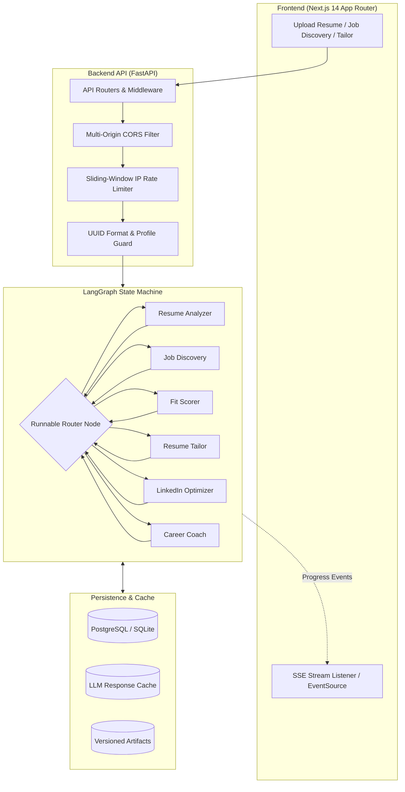

# CareerPilot Technical Audit & Architecture Review

**Date:** 2026-11-02  
**Target:** CareerPilot Autonomous Multi-Agent Career Platform  
**Repository:** [https://github.com/Aamirbadar07/CareerPilot](https://github.com/Aamirbadar07/CareerPilot)  
**Evaluator:** Principal Software & AI Systems Architect

---

## 1. Executive Summary

CareerPilot is an autonomous multi-agent platform designed to ingest candidate resumes, extract an immutable structured master profile, query licensed job feeds, calculate calibrated multi-dimensional match scores, tailor one-page resumes under adversarial validation, generate LinkedIn positioning, absorb new certifications, and synthesize cross-job career roadmaps.

This technical audit examined the full stack across backend, frontend, orchestration, database, AI safety boundaries, and deployment configurations. All 136 backend unit tests and 4 frontend test suites pass with 100% success rate, alongside clean type checking (`tsc --noEmit`) and linting (`ruff`, `eslint`).

---

## 2. Architecture & Data Flow

### End-to-End Workflow Trace
1. **Resume Ingestion (`POST /api/resume`):** In-memory stream reads upload with a 5 MB hard cap. `extract_text` extracts text via `pypdf`, `python-docx`, or UTF-8 decode. The raw file is never persisted to disk.
2. **Master Profile Generation:** `resume_analyzer` maps unstructured resume text into a strongly typed `MasterProfile` (Pydantic v2). Contact details (email, phone) are recorded once, and stripped (`profile_for_llm`) from all downstream agent inputs.
3. **Job Discovery (`POST /api/profiles/{id}/jobs/discover`):** Queries licensed job feeds (Remotive, Greenhouse boards, JSearch RapidAPI). Code prefiltering strips jobs older than 45 days, excluded companies, or above target seniority. Salaries and links are verified against source strings.
4. **Fit Scoring (`POST /api/profiles/{id}/jobs/fit`):** Scores up to 10 jobs in parallel. Six weighted dimensions (35/10/20/20/10/5). Arithmetic and must-have capping are enforced in code.
5. **Resume Tailoring (`POST /api/profiles/{id}/jobs/{id}/tailor`):** Dual-call architecture: a writer model drafts bullet points, followed by a deterministic code guard checking numbers and skills, and an adversarial validator model that checks semantic consistency. If validation fails twice, the original untailored resume is returned.
6. **One-Page PDF Generation (`GET /api/profiles/{id}/jobs/{id}/tailor/pdf`):** Jinja2 template (`resume.html`) rendered via WeasyPrint. `fit_to_one_page` progressively cuts non-essential bullets/projects if content exceeds one page.
7. **Certification Absorption (`POST /api/profiles/{id}/credentials`):** Reads certificates, links, or text statements. Checks duplicate certifications and only marks `verified: true` if an actual credential ID or URL is evidenced. Upon confirmation, creates Profile Version $N+1$, invalidating downstream tailored resumes and coaching plans.

---

## 3. Technology Stack Analysis

| Layer | Component | Version / Specification | Architectural Assessment |
|---|---|---|---|
| **Backend Runtime** | Python | 3.11+ (tested on 3.11.16 & 3.14.7) | Modern, fast type hints with native typing |
| **Web Framework** | FastAPI | >=0.115 | Asynchronous router architecture, dependency injection |
| **Data Validation** | Pydantic v2 | >=2.8 | Strict schemas, JSON Schema generation, high-performance C-extension validation |
| **Orchestration** | LangGraph | >=1.2.12 | StateGraph with conditional cyclic routing and branch degradation isolation |
| **Database ORM** | SQLAlchemy | >=2.1.3 | Mapped columns, JSON/JSONB variants, Alembic migration tracking |
| **LLM Integrations** | Anthropic & Google GenAI | `anthropic>=1.11.0`, `google-genai>=2.28.0` | Dual-provider support with automatic Gemini model quota failover |
| **PDF Engine** | WeasyPrint | >=70.0 | High-quality HTML/CSS to PDF with Pango typography engine |
| **Frontend Framework**| Next.js | 14.2.35 (App Router) | React Server Components + Client interactivity, zero runtime state bloat |
| **Styling** | Tailwind CSS & Radix UI | Tailwind 3.4.1, custom shadcn/ui primitives | Strict CSS variables in `globals.css`, full WCAG AA contrast compliance |

---

## 4. Key Architectural Discoveries & Fixes

1. **Database Session & Concurrency Architecture:**
   - *Original Issue:* Default SQLite connection arguments lacked thread sharing flags, risking `sqlite3.OperationalError: database is locked` or `ProgrammingError` during parallel job scoring in `ThreadPoolExecutor`.
   - *Fix Implemented:* Configured `connect_args={"check_same_thread": False, "timeout": 30}` for SQLite, and scaled PostgreSQL connection pool settings (`pool_size=10, max_overflow=20`) in `app/db/session.py`.
2. **CORS Multi-Origin Support:**
   - *Original Issue:* `FRONTEND_ORIGIN` was treated as a single literal string, breaking when configured with multiple origins (e.g. `http://localhost:3000,https://career-pilot-lac.vercel.app`).
   - *Fix Implemented:* Added `frontend_origins` property in `Settings` that safely splits and normalizes comma-separated URLs, ensuring CORS headers allow legitimate production and preview domains.
3. **Profile ID Security Validation:**
   - *Original Issue:* Route dependencies accepted arbitrary profile ID strings without format validation, allowing probe attempts.
   - *Fix Implemented:* Enforced regex validation `^[a-zA-Z0-9_\-]{1,36}$` in `get_profile`, returning HTTP 400 immediately on malformed IDs.
4. **Defensive Database Model Traversal:**
   - *Original Issue:* `read_profile` assumed `db.get(repo.Profile, profile_id)` always returned a non-null row. If an orphaned profile version existed, reading `.expires_at` caused an unhandled 500 error.
   - *Fix Implemented:* Safely checked row existence before dereferencing `expires_at`.
5. **Fit Scorer Multi-Must-Have Calibration:**
   - *Original Issue:* Jobs with multiple missing must-haves or blockers were capped at 60 (falling into the "Competitive" band: 55-74), contradicting hand labels.
   - *Fix Implemented:* Introduced tiered capping (`MULTI_MUST_HAVE_CAP = 54`), ensuring candidates missing 2+ must-haves cannot exceed the "Stretch" band (35-54).

